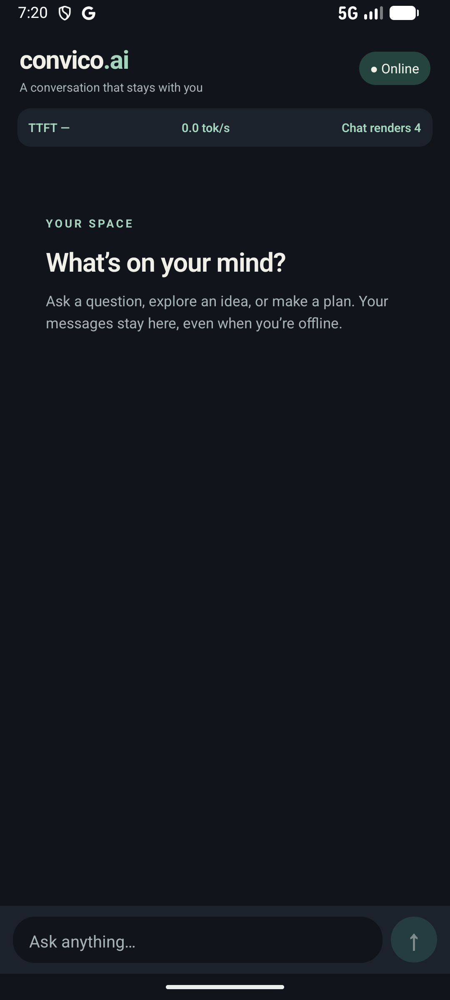
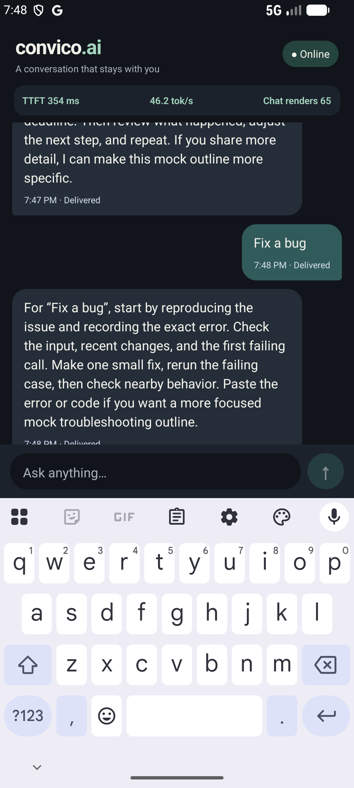

# Convico AI chat challenge

A standalone Expo/React Native TypeScript chat app with a local mock AI stream and durable offline queue. No API key or backend is required.

## Install on an Android phone

[Download the Android APK (Direct Link)](https://github.com/manish77633/convico/raw/main/downloads/convico-android.apk) | [Repo File Link](downloads/convico-android.apk) (45.0 MiB), open it on the phone, and allow installation from your browser or Files app if Android asks. This testing APK contains ARM64 and ARMv7 native libraries for Android phones; x86 emulator libraries are omitted to keep it small. It is signed with the local development key rather than a Play Store release key. SHA-256: `bcc2ad4f258fd8b72ad4385f1d17eb658066b3aaca91b51bc5f15f56c0b6e628`.

## Run

Requires Node 22, npm, and an Android emulator/device. On Windows, clone to a short path such as `E:\c`: Ninja's generated C++ object names can exceed the 260-character path limit when this project sits under a long directory name. The included Expo config plugin puts CMake staging at the project root to shorten release build paths. From the project directory:

```sh
npm ci
npm run android
```

For an APK with the JavaScript bundle included, use `npx expo run:android --variant release`. The debug build needs a live Metro server and cannot start from scratch while the emulator is fully offline. iOS requires macOS/Xcode. The app uses Expo SDK 58, `expo-sqlite`, `expo-audio`, `expo-file-system`, NetInfo, Gesture Handler 3, Reanimated 4, Worklets, Expo Haptics, and Safe Area Context. These were installed with `expo install` to match the SDK. SQLite is included in native Expo runtimes; a browser build is not the target.

## Architecture

- `src/db.ts`: SQLite schema, keyset-paged history, message repository, transaction guarded insertion and delivery, ordered queue.
- `src/reply.ts` and `src/stream.ts`: short Hinglish mock outlines and clock-paced tokens. Different prompt types produce different outlines, but no AI model or fact lookup runs. The acknowledgement returns the stable user message ID as its idempotency key; it **does not contact a remote server**.
- `src/useChat.ts`: React hook coordinating connectivity, paged visible history, database-backed queue draining, bounded response retries, errors, and cleanup.
- `App.tsx`, `src/VoiceRecorder.tsx`, and `src/VoiceMessage.tsx`: virtualized chat list, composer, performance overlay, gestures, haptics, UI-thread pulse, microphone recording controls, live metering waveform, and a single shared voice playback player.

## Voice messages

The composer shows a microphone when empty and a Send button when text is entered. Its emoji control opens a small picker. Tap the mic to request permission and start recording. The compact recording panel shows the real microphone metering waveform and elapsed timer, with Delete, Pause/Resume, and Send controls. Native pause/resume appends to the same recording and excludes paused time. Send finalizes and saves the whole voice message in one tap. Recordings shorter than half a second are rejected; recording stops at two minutes. Moving the app to the background stops recording. Playback supports play, pause, resume, and replay. A single player prevents overlapping voice messages and pauses when the app leaves the foreground.

The download APK includes the voice composer with pause/resume, native multipart voice upload via UploadTask, and Gemini audio TTS playback.

`expo-audio` writes `.m4a` files into the app's persistent document directory; `expo-file-system` checks file existence and deletes canceled recordings. SQLite stores the URI, duration, waveform samples, and message status; it does not store audio BLOBs. Audio messages use the same durable chronological `sync_queue` as text. On reconnect, the local mock acknowledgement changes them from Pending hai to Local sync hua. **There is no audio upload, transcription, remote recipient, or AI voice response.** The voice file remains on this device, so another device cannot play it. An uninstall removes app-private files. The microphone permission is configured by the `expo-audio` config plugin; installing this feature requires a fresh native build/APK, not an OTA JavaScript update.

User messages are inserted into `messages` and `sync_queue` in one exclusive SQLite transaction. App writes are serialized. NetInfo connectivity triggers oldest-first queue draining. Only one worker runs at a time. Acknowledgement and queue removal happen together with status change to `delivered`. On network loss, an in-flight operation aborts. A pending message retains its stable ID and stays queued. Failed assistant responses are persisted and retried at most twice automatically during an online worker pass; tapping Retry allows another manual attempt. A restart turns interrupted `syncing` rows back to `pending` and interrupted `streaming` rows to `failed`.

The mock schedules one whitespace-delimited token every 22 ms against an absolute clock, targeting about 45 tokens/second with room for emulator timer overhead. Line breaks between numbered steps are preserved. React state is painted at most about every 60 ms; individual bubbles are memoized. SQLite loads the newest 64 messages at startup and fetches earlier pages as the user scrolls up; the queue worker reads messages by ID directly from SQLite, even when they are outside the visible page. The active streaming pulse uses Reanimated on the UI thread. The recording waveform follows microphone metering updates; the playback waveform highlights progress from the native player status. TTFT is wall-clock time from the user message creation (or retry request) to the first token; for offline messages it includes queue wait. Token rate is `(tokens - 1) / seconds since first token`, sampled at each UI paint. “Renders” counts renders of the chat screen component since mount, not frames per second. JavaScript timer scheduling may change the actual token rate. A 60 FPS target must be measured on the target device; this number is not an FPS claim.

## Verification

```sh
npx tsc --noEmit
npm run lint
npm test
npx expo-doctor
npm run android
npx expo run:android --variant release
```

Manual demo: send a prompt and watch streaming/metrics; switch Android to airplane mode, send two messages, then reconnect and observe ordered Pending → Syncing → Delivered states; swipe a bubble right to quote it and feel haptic feedback; interrupt connectivity during streaming and observe failure/retry. Restart while offline to confirm queued messages persist.

Before voice messages were added, the Android API 37 emulator checks covered streaming, offline text queue across restart, oldest-first reconnect delivery, swipe-to-reply, retry after a connection drop, and the composer above the keyboard. The visible token-rate overlay read about 45–47 tokens/second during those runs. A debug fixture inserted 5,000 older messages into SQLite; an independent read confirmed 5,006 total messages. These results do not verify the new microphone/audio path. Haptic feel and 60 FPS were not measured on physical hardware.





[Watch the two-minute core demo](docs/convico-demo.mp4) or the [prompt-aware demo](docs/prompt-aware-demo.mp4). Both clips predate the real voice-message update and do not demonstrate microphone recording.

## Submission and limits

The public source repository is [manish77633/convico](https://github.com/manish77633/convico). Both demo videos are included in `docs/`; the commit history uses conventional messages. The 5,000-message fixture and paged loading are implemented, but a cold-load latency or scroll frame benchmark has not been measured. The mock acknowledgement is local only, so cross-device delivery is outside this demo.
